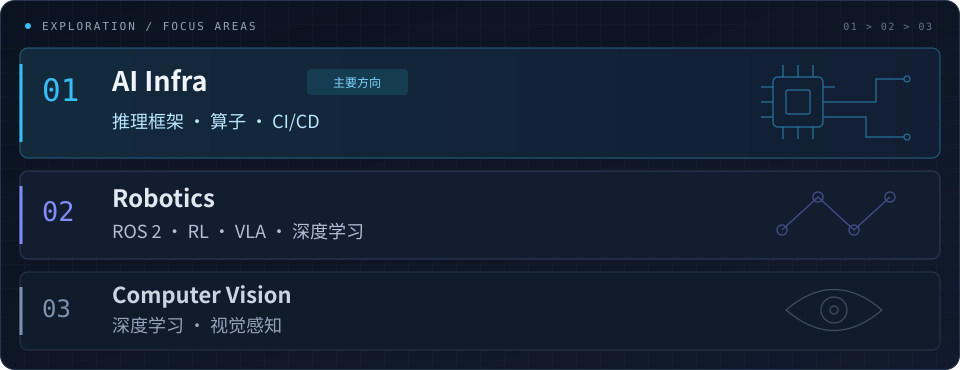

**Hi, I'm wyi 👋**

一名在代码与实践中探索的学生，以 AI Infra 为主要方向，持续探索 Robotics 与计算机视觉。

### 🧭 正在探索 · Currently Exploring

### 🛠️ 技术栈 · Tech Stack

<picture>
  <source media="(prefers-color-scheme: dark)" srcset="https://skillicons.dev/icons?i=python%2Ccpp%2Cc%2Cpytorch%2Copencv%2Cros%2Clinux%2Cgit&amp;theme=dark&amp;perline=8" />
  
</picture>

### 🚀 项目与贡献 · Projects & Contributions

| 方向 | 项目 | 内容 |
| :--- | :--- | :--- |
| ⚙️ AI Infra · 开源贡献 | [Torch-FL](https://github.com/flagos-ai/Torch-FL/pulls?q=is%3Apr+author%3AwyNomad) | 多平台 CI、构建与测试流程改进 |
| 🤖 机器人 | [vm_ros2_ws](https://github.com/wyNomad/vm_ros2_ws) | ROS 2 工作空间与 C++ 开发实践 |
| 👁️ 计算机视觉 | [cv_study](https://github.com/wyNomad/cv_study) | 计算机视觉学习与 Python 实践 |

### 📊 数据一览 · GitHub Stats

<picture>
  <source media="(prefers-color-scheme: dark)" srcset="https://github-profile-summary-cards.vercel.app/api/cards/stats?username=wyNomad&amp;theme=github_dark" />
  
</picture>
<picture>
  <source media="(prefers-color-scheme: dark)" srcset="https://github-profile-summary-cards.vercel.app/api/cards/repos-per-language?username=wyNomad&amp;theme=github_dark" />
  
</picture>
<picture>
  <source media="(prefers-color-scheme: dark)" srcset="https://github-profile-summary-cards.vercel.app/api/cards/most-commit-language?username=wyNomad&amp;theme=github_dark" />
  
</picture>

### 🐍 贡献足迹 · Contribution Snake

<picture>
  <source media="(prefers-color-scheme: dark)" srcset="https://raw.githubusercontent.com/wyNomad/wyNomad/output/github-contribution-grid-snake-dark.svg?v=1" />
  
</picture>

 
保持好奇，持续构建。 · Stay curious. Keep building.

